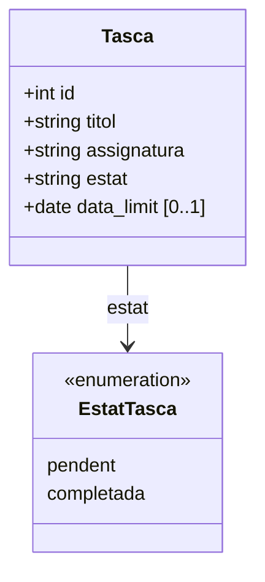

# SPECIFICATIONS.md — Sistema Tasks_app (v2.0)

## 0. Historial de Versions
| Versió | Iteració | Canvis |
|--------|----------|--------|
| v1.0 | Sprint 1 | Especificació inicial: US-01, US-02, RF-01..RF-04, GS-01..GS-03. |
| v1.1 | Sprint 1 | Millora de cobertura: RF-05, RF-06, RNF-01..RNF-03, GS-04..GS-06. |
| v2.0 | Sprint 2 | Data límit, modificació, completar tasques i avisos al llistat: US-03..US-06, RF-07..RF-20, RNF-04..RNF-05, GS-07..GS-19. RNF-01, RF-04 i RF-06 ampliats (compatibles amb v1.x); GS-06b. |

> Els elements nous o modificats a cada versió s'indiquen amb l'etiqueta `[vX.Y]`.

## 1. Visió General
Tasks_app és una eina CLI lleugera per ajudar als estudiants a gestionar les seves tasques acadèmiques diàries.

## 2. User Stories (Històries d'Usuari)
- US-01: Com a estudiant, vull afegir una tasca amb títol i assignatura per tal de recordar els meus deures.
- US-02: Com a estudiant, vull veure la llista de tasques registrades per tal d'organitzar el meu temps.
- US-03 `[v2.0]`: Com a estudiant, vull indicar la data límit d'una tasca en donar-la d'alta per tal de saber quan l'he de tenir acabada.
- US-04 `[v2.0]`: Com a estudiant, vull modificar qualsevol atribut d'una tasca a partir del seu ID per tal de corregir els errors comesos en registrar-la.
- US-05 `[v2.0]`: Com a estudiant, vull marcar una tasca com a completada per tal de distingir la feina feta de la pendent.
- US-06 `[v2.0]`: Com a estudiant, vull que el llistat m'avisi de les tasques pendents caducades o urgents per tal de prioritzar-les.

## 3. Model de Dades (Mermaid)

## 4. Requisits

### 4.1 Requisits Funcionals

#### Creació i llistat (v1.x)
- RF-01: El sistema tasks_app ha de guardar les tasques en un fitxer JSON de persistència local.
- RF-02: Si el fitxer `data/tasks.json` no existeix, el sistema tasks_app ha de crear `data/tasks.json` inicialitzat amb una llista JSON buida (`[]`).
- RF-03: El sistema tasks_app ha de proveir a l'estudiant la capacitat de crear una nova tasca amb estat `pendent` mitjançant el comandament `add --title <títol> --subject <assignatura>`.
- RF-04 `[v2.0]`: El sistema tasks_app ha de proveir a l'estudiant la capacitat de visualitzar totes les tasques registrades (incloent-hi el seu ID, títol, assignatura, estat i, si en té, la data límit) mitjançant el comandament `list`.
- RF-05: Quan es crea una tasca, el sistema tasks_app ha d'assignar-li un ID enter igual al màxim ID existent més 1 (o 1 si el registre és buit).
- RF-06: Si el comandament `add` no inclou les opcions `--title` i `--subject`, el sistema tasks_app ha de mostrar un missatge d'error, finalitzar amb un codi de sortida diferent de 0 i no ha de modificar `data/tasks.json`.
  - `[v2.0]` Si el valor de `--title` o de `--subject` (als comandaments `add` o `edit`) és buit o només conté espais, el sistema tasks_app ha de mostrar `Error: el títol i l'assignatura no poden ser buits.`, finalitzar amb un codi de sortida diferent de 0 i no ha de modificar `data/tasks.json`.

#### Data límit `[v2.0]`
- RF-07: El sistema tasks_app ha de proveir a l'estudiant la capacitat d'indicar opcionalment la data límit d'una nova tasca mitjançant l'opció `--due <YYYY-MM-DD>` del comandament `add`.
- RF-08: Si el comandament `add` no inclou l'opció `--due`, el sistema tasks_app ha de registrar la tasca sense data límit (valor `null`).
- RF-09: Si el valor de l'opció `--due` no és una data vàlida en format `YYYY-MM-DD`, el sistema tasks_app ha de mostrar el missatge `Error: la data límit ha de tenir el format YYYY-MM-DD.`, finalitzar amb un codi de sortida diferent de 0 i no ha de modificar `data/tasks.json`.

#### Modificació de tasques `[v2.0]`
- RF-10: El sistema tasks_app ha de proveir a l'estudiant la capacitat de modificar el títol, l'assignatura, la data límit i l'estat d'una tasca existent mitjançant el comandament `edit --id <ID> [--title <títol>] [--subject <assignatura>] [--due <YYYY-MM-DD>] [--status <estat>]`.
- RF-11: Quan es modifica una tasca, el sistema tasks_app ha d'actualitzar únicament els atributs indicats, mantenir sense canvis la resta d'atributs i l'ID, i mostrar `Tasca [ID: <ID>] modificada amb èxit`.
- RF-12: Si no existeix cap tasca amb l'ID indicat als comandaments `edit` o `complete`, el sistema tasks_app ha de mostrar `Error: no existeix cap tasca amb ID <ID>.`, finalitzar amb un codi de sortida diferent de 0 i no ha de modificar `data/tasks.json`.
- RF-13: Si el comandament `edit` no inclou cap atribut a modificar, el sistema tasks_app ha de mostrar `Error: cal indicar almenys un atribut a modificar.` i finalitzar amb un codi de sortida diferent de 0.
- RF-14: Si el valor de l'opció `--status` no és `pendent` ni `completada`, el sistema tasks_app ha de mostrar `Error: l'estat ha de ser 'pendent' o 'completada'.`, finalitzar amb un codi de sortida diferent de 0 i no ha de modificar `data/tasks.json`.
- RF-15: Si el valor de l'opció `--due` del comandament `edit` no és una data vàlida en format `YYYY-MM-DD`, el sistema tasks_app ha d'aplicar el mateix comportament que RF-09.

#### Completar tasques `[v2.0]`
- RF-16: El sistema tasks_app ha de proveir a l'estudiant la capacitat de canviar l'estat d'una tasca a `completada` mitjançant el comandament `complete --id <ID>`, mostrant `Tasca [ID: <ID>] marcada com a completada`.
- RF-17: Si la tasca indicada al comandament `complete` ja té l'estat `completada`, el sistema tasks_app ha de mostrar `La tasca [ID: <ID>] ja estava completada.` sense modificar `data/tasks.json`.

#### Avisos al llistat `[v2.0]`
- RF-18: Si una tasca té data límit, el sistema tasks_app ha d'afegir ` - data límit: <YYYY-MM-DD>` a la seva línia del llistat. Si no en té, la línia ha de mantenir el format de la v1.x.
- RF-19: Si una tasca té estat `pendent` i la seva data límit és anterior a la data actual, el sistema tasks_app ha d'afegir l'indicador ` [CADUCADA]` al final de la seva línia del llistat.
- RF-20: Si una tasca té estat `pendent` i la seva data límit és igual o posterior a la data actual i anterior a la data actual més 7 dies (és a dir, falten entre 0 i 6 dies), el sistema tasks_app ha d'afegir l'indicador ` [URGENT]` al final de la seva línia del llistat.
  - Les tasques `completada` i les tasques sense data límit no mostren mai cap indicador.

### 4.2 Requisits No Funcionals
- RNF-01 `[v2.0]`: El sistema tasks_app ha d'emmagatzemar cada tasca a `data/tasks.json` com un objecte JSON amb les claus `id`, `titol`, `assignatura`, `estat` i `data_limit` (cadena `YYYY-MM-DD` o `null`), codificat en UTF-8.
- RNF-02: El sistema tasks_app ha de resoldre la ruta `data/tasks.json` de manera relativa al directori de treball actual.
- RNF-03: El sistema tasks_app ha de funcionar amb Python 3.11 o superior utilitzant només la biblioteca estàndard.
- RNF-04 `[v2.0]`: El sistema tasks_app ha de ser capaç de llegir fitxers `data/tasks.json` creats amb la v1.x (sense clau `data_limit`), tractant aquestes tasques com a tasques sense data límit.
- RNF-05 `[v2.0]`: El sistema tasks_app ha d'obtenir la data actual del rellotge del sistema. Si la variable d'entorn `TASKS_APP_AVUI` conté una data `YYYY-MM-DD`, el sistema tasks_app ha d'utilitzar aquesta data com a data actual (per a proves deterministes).

## 5. Criteris d'acceptació i proves (Gherkin scenarios)

### 5.1 Creació i llistat (v1.x)
- GS-01: Creació correcta d'una tasca (RF-03, RF-05)
  Atès que la base de dades JSON no conté encara tasques
  quan l'estudiant executa `python src/tasks_app.py add --title 'Pràctica 1' --subject 'RS'`
  aleshores el sistema confirma `Tasca [ID: 1] creada amb èxit`
  i la tasca queda registrada al fitxer `data/tasks.json` amb estat `pendent`.

- GS-02: Llistat de tasques quan `data/tasks.json` no conté registres (RF-04)
  Atès que la base de dades JSON no conté encara tasques
  quan l'estudiant executa `python src/tasks_app.py list`
  aleshores el sistema mostra `Registre de tasques buit.`

- GS-03: Llistat de tasques quan `data/tasks.json` conté registres (RF-04)
  Atès que el fitxer `data/tasks.json` conté les següents tasques:
    | id | títol          | assignatura | estat   |
    | 1  | Pràctica 1     | RS          | pendent |
    | 2  | Examen parcial | SO          | pendent |
  quan l'estudiant executa `python src/tasks_app.py list`
  aleshores el sistema mostra per pantalla:
    "[1] Pràctica 1 (RS) - estat: pendent"
    "[2] Examen parcial (SO) - estat: pendent"

- GS-04: Creació automàtica del fitxer de persistència (RF-02)
  Atès que el fitxer `data/tasks.json` no existeix
  quan l'estudiant executa `python src/tasks_app.py list`
  aleshores el sistema crea el fitxer `data/tasks.json` amb el contingut `[]`
  i mostra `Registre de tasques buit.`

- GS-05: Assignació d'ID incremental (RF-05)
  Atès que el fitxer `data/tasks.json` conté una tasca amb ID 1
  quan l'estudiant executa `python src/tasks_app.py add --title 'Examen parcial' --subject 'SO'`
  aleshores el sistema confirma `Tasca [ID: 2] creada amb èxit`
  i el fitxer `data/tasks.json` conté 2 tasques.

- GS-06: Creació d'una tasca sense assignatura (RF-06)
  Atès que la base de dades JSON no conté encara tasques
  quan l'estudiant executa `python src/tasks_app.py add --title 'Pràctica 1'`
  aleshores el sistema mostra un missatge d'error
  i finalitza amb un codi de sortida diferent de 0
  i el fitxer `data/tasks.json` continua sense tasques.

- GS-06b `[v2.0]`: Creació d'una tasca amb títol buit (RF-06)
  Atès que la base de dades JSON no conté encara tasques
  quan l'estudiant executa `python src/tasks_app.py add --title '' --subject 'RS'`
  aleshores el sistema mostra `Error: el títol i l'assignatura no poden ser buits.`
  i finalitza amb un codi de sortida diferent de 0
  i el fitxer `data/tasks.json` continua sense tasques.

### 5.2 Data límit `[v2.0]`
- GS-07: Creació d'una tasca amb data límit (RF-07, RNF-01)
  Atès que la base de dades JSON no conté encara tasques
  quan l'estudiant executa `python src/tasks_app.py add --title 'Pràctica 2' --subject 'RS' --due 2026-12-15`
  aleshores el sistema confirma `Tasca [ID: 1] creada amb èxit`
  i la tasca queda registrada a `data/tasks.json` amb `data_limit` igual a `2026-12-15`.

- GS-08: Creació d'una tasca sense data límit (RF-08)
  Atès que la base de dades JSON no conté encara tasques
  quan l'estudiant executa `python src/tasks_app.py add --title 'Lectura' --subject 'IA'`
  aleshores la tasca queda registrada a `data/tasks.json` amb `data_limit` igual a `null`.

- GS-09: Creació d'una tasca amb data límit en format incorrecte (RF-09)
  Atès que la base de dades JSON no conté encara tasques
  quan l'estudiant executa `python src/tasks_app.py add --title 'Pràctica 2' --subject 'RS' --due 15/12/2026`
  aleshores el sistema mostra `Error: la data límit ha de tenir el format YYYY-MM-DD.`
  i finalitza amb un codi de sortida diferent de 0
  i el fitxer `data/tasks.json` continua sense tasques.

- GS-10: Lectura d'un registre creat amb la v1.x (RNF-04)
  Atès que el fitxer `data/tasks.json` conté la tasca `{"id": 1, "titol": "Pràctica 1", "assignatura": "RS", "estat": "pendent"}` sense clau `data_limit`
  quan l'estudiant executa `python src/tasks_app.py list`
  aleshores el sistema mostra `[1] Pràctica 1 (RS) - estat: pendent`
  i no mostra cap error.

### 5.3 Modificació de tasques `[v2.0]`
- GS-11: Modificació d'un atribut d'una tasca (RF-10, RF-11)
  Atès que el fitxer `data/tasks.json` conté la tasca:
    | id | títol      | assignatura | estat   | data_limit |
    | 1  | Practica 1 | RS          | pendent | 2026-12-01 |
  quan l'estudiant executa `python src/tasks_app.py edit --id 1 --title 'Pràctica 1'`
  aleshores el sistema confirma `Tasca [ID: 1] modificada amb èxit`
  i la tasca 1 té títol `Pràctica 1`, assignatura `RS`, estat `pendent` i data límit `2026-12-01`.

- GS-12: Modificació de diversos atributs alhora (RF-10, RF-11)
  Atès que el fitxer `data/tasks.json` conté la tasca:
    | id | títol      | assignatura | estat   | data_limit |
    | 1  | Pràctica 1 | SO          | pendent | 2026-12-01 |
  quan l'estudiant executa `python src/tasks_app.py edit --id 1 --subject 'RS' --due 2026-12-10`
  aleshores el sistema confirma `Tasca [ID: 1] modificada amb èxit`
  i la tasca 1 té assignatura `RS` i data límit `2026-12-10`
  i el títol continua sent `Pràctica 1`.

- GS-13: Modificació d'una tasca inexistent (RF-12)
  Atès que el fitxer `data/tasks.json` conté només la tasca amb ID 1
  quan l'estudiant executa `python src/tasks_app.py edit --id 99 --title 'Nou títol'`
  aleshores el sistema mostra `Error: no existeix cap tasca amb ID 99.`
  i finalitza amb un codi de sortida diferent de 0
  i el fitxer `data/tasks.json` no canvia.

- GS-14: Modificació sense indicar cap atribut (RF-13)
  Atès que el fitxer `data/tasks.json` conté la tasca amb ID 1
  quan l'estudiant executa `python src/tasks_app.py edit --id 1`
  aleshores el sistema mostra `Error: cal indicar almenys un atribut a modificar.`
  i finalitza amb un codi de sortida diferent de 0.

- GS-15: Modificació amb un estat no vàlid (RF-14)
  Atès que el fitxer `data/tasks.json` conté la tasca amb ID 1 i estat `pendent`
  quan l'estudiant executa `python src/tasks_app.py edit --id 1 --status acabada`
  aleshores el sistema mostra `Error: l'estat ha de ser 'pendent' o 'completada'.`
  i finalitza amb un codi de sortida diferent de 0
  i la tasca 1 continua amb estat `pendent`.

### 5.4 Completar tasques `[v2.0]`
- GS-16: Marcar una tasca pendent com a completada (RF-16)
  Atès que el fitxer `data/tasks.json` conté la tasca amb ID 1 i estat `pendent`
  quan l'estudiant executa `python src/tasks_app.py complete --id 1`
  aleshores el sistema confirma `Tasca [ID: 1] marcada com a completada`
  i la tasca 1 queda registrada amb estat `completada`.

- GS-17: Marcar com a completada una tasca que ja ho estava (RF-17)
  Atès que el fitxer `data/tasks.json` conté la tasca amb ID 1 i estat `completada`
  quan l'estudiant executa `python src/tasks_app.py complete --id 1`
  aleshores el sistema mostra `La tasca [ID: 1] ja estava completada.`
  i el fitxer `data/tasks.json` no canvia.

- GS-18: Completar una tasca inexistent (RF-12)
  Atès que el fitxer `data/tasks.json` no conté cap tasca amb ID 7
  quan l'estudiant executa `python src/tasks_app.py complete --id 7`
  aleshores el sistema mostra `Error: no existeix cap tasca amb ID 7.`
  i finalitza amb un codi de sortida diferent de 0.

### 5.5 Avisos al llistat `[v2.0]`
- GS-19: Llistat amb tasques caducades, urgents i sense avís (RF-18, RF-19, RF-20, RNF-05)
  Atès que la data actual és `2026-11-24` (variable `TASKS_APP_AVUI=2026-11-24`)
  i el fitxer `data/tasks.json` conté les següents tasques:
    | id | títol          | assignatura | estat      | data_limit |
    | 1  | Lliurament P4  | RS          | pendent    | 2026-11-20 |
    | 2  | Examen parcial | SO          | pendent    | 2026-11-24 |
    | 3  | Pràctica 2     | GABD        | pendent    | 2026-11-30 |
    | 4  | Pràctica 3     | TDIW        | pendent    | 2026-12-01 |
    | 5  | Informe        | RS          | completada | 2026-11-20 |
    | 6  | Lectura        | IA          | pendent    | null       |
  quan l'estudiant executa `python src/tasks_app.py list`
  aleshores el sistema mostra per pantalla:
    "[1] Lliurament P4 (RS) - estat: pendent - data límit: 2026-11-20 [CADUCADA]"
    "[2] Examen parcial (SO) - estat: pendent - data límit: 2026-11-24 [URGENT]"
    "[3] Pràctica 2 (GABD) - estat: pendent - data límit: 2026-11-30 [URGENT]"
    "[4] Pràctica 3 (TDIW) - estat: pendent - data límit: 2026-12-01"
    "[5] Informe (RS) - estat: completada - data límit: 2026-11-20"
    "[6] Lectura (IA) - estat: pendent"
