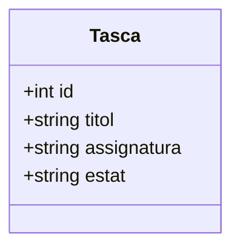

# SPECIFICATIONS.md — Sistema Tasks_app (v1.1)

## 0. Historial de Versions
| Versió | Iteració | Canvis |
|--------|----------|--------|
| v1.0 | Sprint 1 | Especificació inicial: US-01, US-02, RF-01..RF-04, GS-01..GS-03. |
| v1.1 | Sprint 1 | Millora de cobertura: RF-05, RF-06, RNF-01..RNF-03, GS-04..GS-06. |

## 1. Visió General
Tasks_app és una eina CLI lleugera per ajudar als estudiants a gestionar les seves tasques acadèmiques diàries.

## 2. User Stories (Històries d'Usuari)
- US-01: Com a estudiant, vull afegir una tasca amb títol i assignatura per tal de recordar els meus deures.
- US-02: Com a estudiant, vull veure la llista de tasques registrades per tal d'organitzar el meu temps.

## 3. Model de Dades (Mermaid)

## 4. Requisits

### 4.1 Requisits Funcionals
- RF-01: El sistema tasks_app ha de guardar les tasques en un fitxer JSON de persistència local.
- RF-02: Si el fitxer `data/tasks.json` no existeix, el sistema tasks_app ha de crear `data/tasks.json` inicialitzat amb una llista JSON buida (`[]`).
- RF-03: El sistema tasks_app ha de proveir a l'estudiant la capacitat de crear una nova tasca amb estat `pendent` mitjançant el comandament `add --title <títol> --subject <assignatura>`.
- RF-04: El sistema tasks_app ha de proveir a l'estudiant la capacitat de visualitzar totes les tasques registrades (incloent-hi el seu ID, títol, assignatura i estat) mitjançant el comandament `list`.
- RF-05: Quan es crea una tasca, el sistema tasks_app ha d'assignar-li un ID enter igual al màxim ID existent més 1 (o 1 si el registre és buit).
- RF-06: Si el comandament `add` no inclou les opcions `--title` i `--subject`, el sistema tasks_app ha de mostrar un missatge d'error, finalitzar amb un codi de sortida diferent de 0 i no ha de modificar `data/tasks.json`.

### 4.2 Requisits No Funcionals
- RNF-01: El sistema tasks_app ha d'emmagatzemar cada tasca a `data/tasks.json` com un objecte JSON amb les claus `id`, `titol`, `assignatura` i `estat`, codificat en UTF-8.
- RNF-02: El sistema tasks_app ha de resoldre la ruta `data/tasks.json` de manera relativa al directori de treball actual.
- RNF-03: El sistema tasks_app ha de funcionar amb Python 3.11 o superior utilitzant només la biblioteca estàndard.

## 5. Criteris d'acceptació i proves (Gherkin scenarios)
- GS-01: Creació correcta d'una tasca (RF-03, RF-05)
  Atès que la base de dades JSON no conté encara tasques
  quan l'estudiant executa `python src/tasks_app.py add --title 'Pràctica 1' --subject 'RS'`
  aleshores el sistema confirma `Tasca [ID: 1] creada amb èxit`
  i la tasca queda registrada al fitxer `data/tasks.json` amb estat `pendent`.

- GS-02: Llistat de tasques quan `data/tasks.json` no conté registres (RF-04)
  Atès que la base de dades JSON no conté encara tasques
  quan l'estudiant executa `python src/tasks_app.py list`
  aleshores el sistema mostra `Registre de tasques buit.`

- GS-03: Llistat de tasques quan `data/tasks.json` conté registres (RF-04)
  Atès que el fitxer `data/tasks.json` conté les següents tasques:
    | id | títol          | assignatura | estat   |
    | 1  | Pràctica 1     | RS          | pendent |
    | 2  | Examen parcial | SO          | pendent |
  quan l'estudiant executa `python src/tasks_app.py list`
  aleshores el sistema mostra per pantalla:
    "[1] Pràctica 1 (RS) - estat: pendent"
    "[2] Examen parcial (SO) - estat: pendent"

- GS-04: Creació automàtica del fitxer de persistència (RF-02)
  Atès que el fitxer `data/tasks.json` no existeix
  quan l'estudiant executa `python src/tasks_app.py list`
  aleshores el sistema crea el fitxer `data/tasks.json` amb el contingut `[]`
  i mostra `Registre de tasques buit.`

- GS-05: Assignació d'ID incremental (RF-05)
  Atès que el fitxer `data/tasks.json` conté una tasca amb ID 1
  quan l'estudiant executa `python src/tasks_app.py add --title 'Examen parcial' --subject 'SO'`
  aleshores el sistema confirma `Tasca [ID: 2] creada amb èxit`
  i el fitxer `data/tasks.json` conté 2 tasques.

- GS-06: Creació d'una tasca sense assignatura (RF-06)
  Atès que la base de dades JSON no conté encara tasques
  quan l'estudiant executa `python src/tasks_app.py add --title 'Pràctica 1'`
  aleshores el sistema mostra un missatge d'error
  i finalitza amb un codi de sortida diferent de 0
  i el fitxer `data/tasks.json` continua sense tasques.
